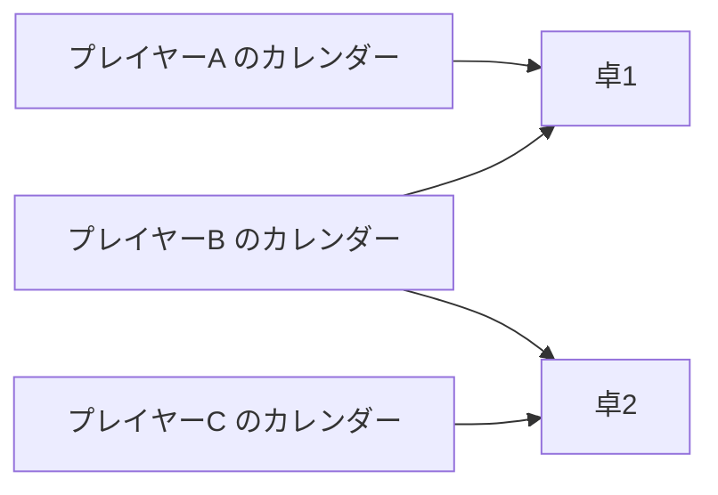
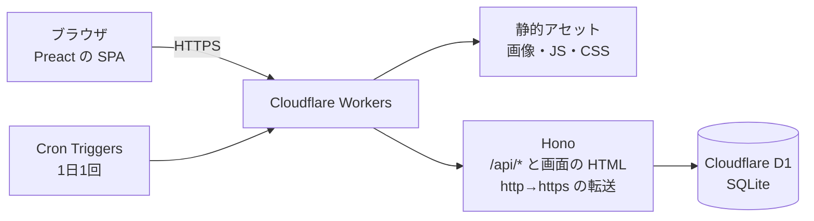
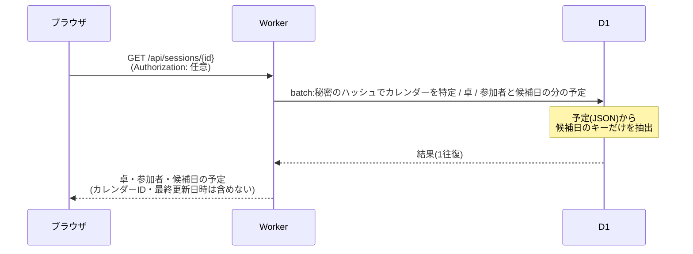
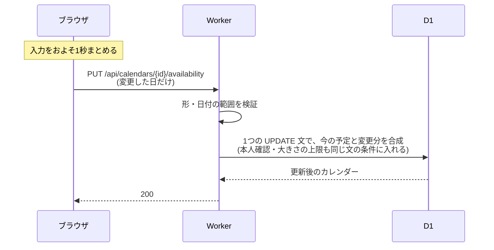
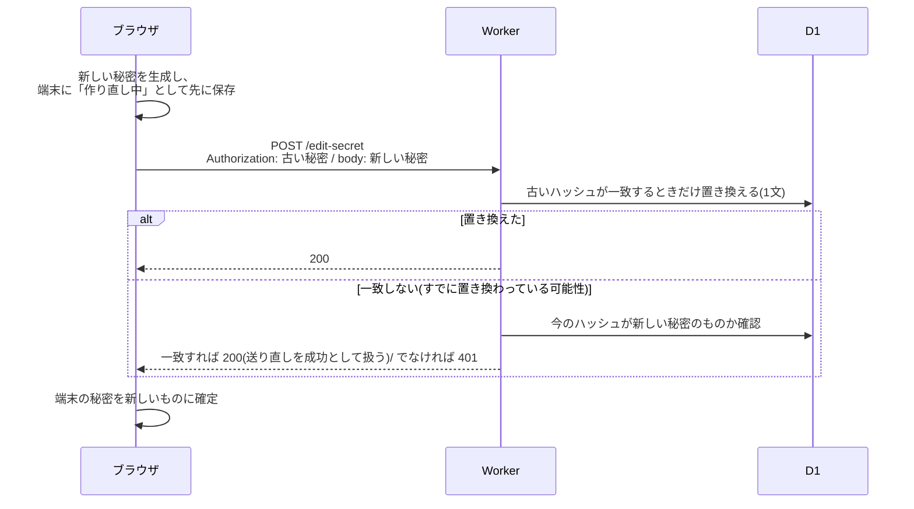
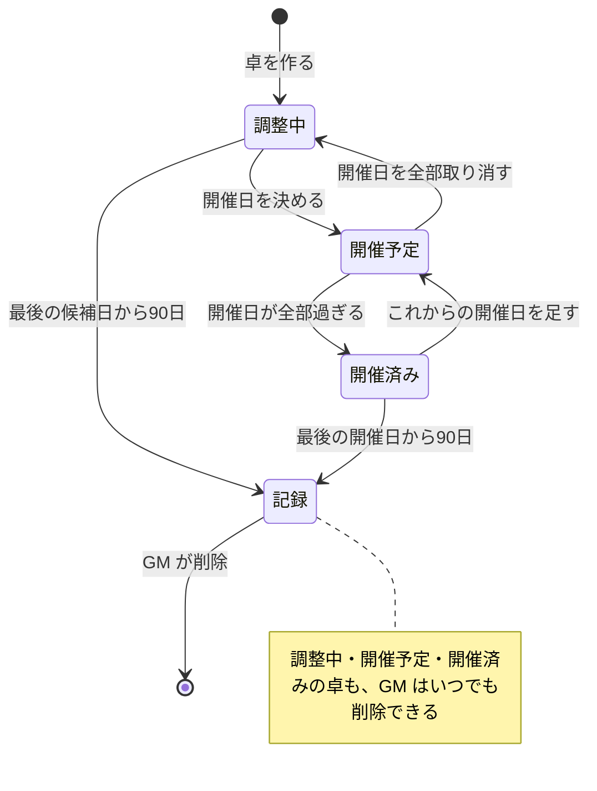
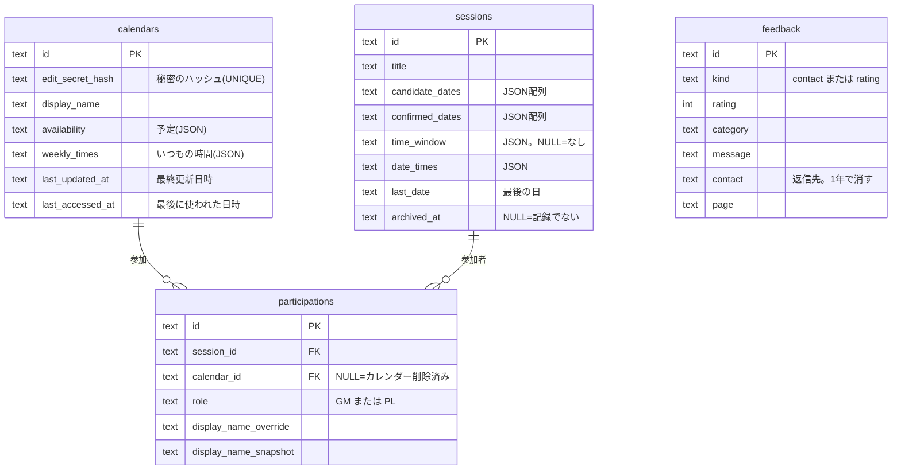

# たくよせ 仕様書

TRPG(テーブルトークRPG)のセッション日程を調整する Web アプリ「たくよせ」の仕様書。
サービスの目的、システム構成、認証の仕組み、機能、データの扱い、セキュリティ、API、データモデル、非機能要件をまとめる。

- 公開URL(予定):`https://takuyose.s1somaru.workers.dev`
- ソースコード:[github.com/s1somaru/takuyose](https://github.com/s1somaru/takuyose)

<a id="toc"></a>

## 目次

1. [はじめに](#intro)
2. [サービス概要](#overview)
3. [用語](#terms)
4. [システム構成](#architecture)
   - [4.1 構成図](#arch-diagram)
   - [4.2 技術スタック](#arch-stack)
   - [4.3 主なデータの流れ](#arch-flow)
5. [認証と権限のモデル](#auth)
   - [5.1 ケイパビリティURL方式](#auth-capability)
   - [5.2 権限の種類](#auth-roles)
   - [5.3 編集URLの作り直し](#auth-reissue)
   - [5.4 編集URLをなくしたとき](#auth-lost)
6. [利用の流れ](#flow)
7. [機能仕様](#features)
   - [7.1 個人カレンダー](#f-calendar)
   - [7.2 予定](#f-availability)
   - [7.3 時刻と「いつもの時間」](#f-time)
   - [7.4 卓](#f-session)
   - [7.5 参加と役割](#f-participation)
   - [7.6 開催できる日の判定](#f-judgement)
   - [7.7 開催日](#f-confirmed)
   - [7.8 卓のライフサイクルと記録](#f-lifecycle)
   - [7.9 祝日](#f-holiday)
   - [7.10 端末に保存する情報](#f-device)
   - [7.11 URLを共有したときの表示](#f-share-card)
   - [7.12 お問い合わせと評価](#f-feedback)
8. [データの扱いとプライバシー](#privacy)
9. [セキュリティ](#security)
   - [9.1 想定する脅威と対策](#sec-threats)
   - [9.2 データの整合性と同時実行](#sec-consistency)
   - [9.3 XSS](#sec-xss)
   - [9.4 CSRF](#sec-csrf)
   - [9.5 セキュリティヘッダ](#sec-headers)
10. [API仕様](#api)
    - [10.1 共通ルール](#api-common)
    - [10.2 エラー](#api-errors)
    - [10.3 個人カレンダーAPI](#api-calendars)
    - [10.4 卓API](#api-sessions)
    - [10.5 お問い合わせ・評価API](#api-feedback)
11. [データモデル](#data)
12. [入力の制限と回数制限](#limits)
13. [非機能要件と運用](#nonfunctional)
14. [既知の制約と割り切り](#tradeoffs)

---

<a id="intro"></a>

## 1. はじめに

### 1.1 この文書の目的と範囲

この文書は、たくよせが **何をするか**(機能・ルール・データの扱い)と、**どう作られているか**(構成・認証・API・データモデル)を定義する。画面の配置や見た目の細部は扱わない。

### 1.2 対象とする読者

- サービスの仕組みや設計を知りたい人
- ソースコードを読む前に、全体像をつかみたい開発者

### 1.3 前提条件と動作環境

| 項目 | 内容 |
|---|---|
| 想定する利用者 | 日本国内の TRPG プレイヤー。画面は日本語のみ |
| タイムゾーン | **日本時間(Asia/Tokyo)固定**。「今日」・入力できる期間・定期処理の時刻はすべて日本時間で決める |
| 端末 | スマートフォンを主とし、PC でも利用できる |
| ブラウザ | 現行の主要ブラウザ。Web Crypto API(乱数生成)・localStorage・`Intl.Segmenter`(文字数の数え方)を使う。クリップボード・共有機能(Web Share API)は使える端末でのみ使う |

### 1.4 表記

- 日付は `YYYY-MM-DD`、時刻は `HH:MM`、日時は UTC の ISO 8601 で書く
- 予定の記号は ◯(参加できる)・△(たぶん参加できる)・×(参加できない)。API では `"o"`・`"t"`・`"x"` で表す

[▲ 目次へ](#toc)

---

<a id="overview"></a>

## 2. サービス概要

### 2.1 解決したい課題

一般的な日程調整サービスは、調整ページ(イベント)ごとに予定を入力する。TRPG のプレイヤーは複数の卓(セッションのグループ)に同時に参加することが多く、**同じ予定を卓の数だけ入力し直す** 手間がかかる。予定が変わったときも、すべての調整ページを直す必要がある。

### 2.2 解決のしかた

**1人が1つの個人カレンダーを持ち、GM(進行役)が作る卓のページがそれを参照する。**



- 予定は自分のカレンダーに1回入れるだけで、参加しているすべての卓に反映される
- 卓は予定のコピーを持たず、表示のたびに参加者のカレンダーを参照する(ライブ参照)。卓に見せるのは、その卓の候補日に当たる日の予定だけ
- 卓ページは、ほかのタブやアプリから戻ってきたときに読み直す(前に読んでから30秒以内なら読まない)。一定の間隔での自動の読み直しはしない

### 2.3 設計の方針

| 方針 | 内容 |
|---|---|
| ログインなし | アカウント登録・パスワードを作らない。推測できないURLを知っていることを権限とする([5章](#auth)) |
| 見せる範囲を最小に | 卓には候補日の予定だけを見せる。他の日の予定や、予定を最後に変えた日時は見せない |
| 説明なしで使える | 1つの画面でやることを絞る。予定の入力は自動で保存する |
| セキュリティを優先 | XSS・SQLインジェクション・CSRF などの代表的な攻撃に対策する([9章](#security)) |
| 低コスト・軽量 | Cloudflare の無料枠の範囲で動かす。外部サービス(解析ツール・広告など)を使わない |

[▲ 目次へ](#toc)

---

<a id="terms"></a>

## 3. 用語

### 3.1 サービスの用語

| 用語 | 意味 |
|---|---|
| 個人カレンダー | 1人が持つ予定表。日ごとに ◯/△/× と、任意の時刻・メモを入れる |
| 卓 | GM が作る日程調整のページ。候補日と参加者を持つ |
| GM / PL | 卓での役割。GM(ゲームマスター)は卓を管理でき、開催できる日の判定にも使われる。PL はプレイヤー |
| 候補日 | GM が卓に設定する、開催するかもしれない日 |
| 開催日 | GM が候補日から選んで決めた日。1つの卓に複数あってよい |
| 卓の時間帯 | 卓を開催する時間帯(例:21:00〜)。任意 |
| 日ごとの時間帯 | 特定の日だけ卓の時間帯と違う時間帯にするための設定(API の `dateTimes`) |
| 空いている時間 | 個人カレンダーの1日分に付ける時間帯(例:20:00〜24:00)。任意 |
| いつもの時間 | 曜日ごとに登録しておく「空いている時間」の既定値 |
| 記録 | 終わった卓を、予定を除いた軽い形にして残したもの |

### 3.2 設計の用語

| 用語 | 意味 |
|---|---|
| ケイパビリティURL | 推測できない秘密を含み、「URLを知っていること」が権限になるURL |
| editSecret | 個人カレンダーの秘密(256bit のランダム値)。これを知っていることが本人の証明になる |
| 編集URL | editSecret を含む、個人カレンダーを編集するためのURL(`/c/{カレンダーID}#{editSecret}`) |
| 卓URL | 卓を見るためのURL(`/s/{卓ID}`)。秘密は含まない |
| ライブ参照 | 卓が予定のコピーを持たず、取得のたびに参加者のカレンダーから候補日の分を取り出すこと |

[▲ 目次へ](#toc)

---

<a id="architecture"></a>

## 4. システム構成

<a id="arch-diagram"></a>

### 4.1 構成図



- 画面と API を同じ Worker から配信する(ドメインが1つで、CORS が不要)
- 画面は SPA(Single Page Application)。`/api/*` と卓ページ(`/s/*`)だけを Worker のコードで処理し、それ以外は静的アセットとしてそのまま返す
  - 卓ページを Worker で処理するのは、URLを共有したときのカードに卓のタイトルを入れるため([7.11](#f-share-card))
- サーバー側の状態はすべて D1 に置く。セッションやキャッシュのための別のストアは持たない

<a id="arch-stack"></a>

### 4.2 技術スタック

| 役割 | 採用 | 選んだ理由 |
|---|---|---|
| 実行環境 | Cloudflare Workers | 無料枠が大きい。画面と API を1か所から配信できる |
| API | Hono | Workers で動く軽量なフレームワーク |
| データベース | Cloudflare D1(SQLite) | Workers から直接使える。SQL で条件つきの更新を書ける |
| 画面 | Preact + Vite | React と同じ書き方で、配信サイズが小さい |
| 言語 | TypeScript | サーバーと画面で型を共有する |
| 入力検証 | Valibot | サーバーと画面で同じ検証の定義を使う |
| QRコード | qrcode-generator | ブラウザ内で生成し、外部に送らない |
| テスト | Vitest + @cloudflare/vitest-plugin | Workers と同じ環境で、D1・回数制限を含めて実行できる |

<a id="arch-flow"></a>

### 4.3 主なデータの流れ

#### 卓の取得(ライブ参照)

参加者のカレンダーから、候補日に当たる日の予定だけを **データベースの中で** 取り出す。全期間の予定はアプリ側に運ばない。認証・卓・参加者の問い合わせは1往復にまとめる。



#### 予定の保存



[▲ 目次へ](#toc)

---

<a id="auth"></a>

## 5. 認証と権限のモデル

<a id="auth-capability"></a>

### 5.1 ケイパビリティURL方式

ログインの代わりに、推測できない秘密を含むURLで権限を表す。

| 段階 | 内容 |
|---|---|
| 生成 | カレンダーの作成時にサーバーが editSecret(`sec_` + 256bit のランダム値)を作り、応答で1回だけ返す |
| 保存(サーバー) | 秘密そのものは保存せず、SHA-256 のハッシュ値だけを保存する。十分に長いランダム値なので、パスワード用の遅いハッシュは使わない |
| 保存(利用者) | 編集URL `/c/{カレンダーID}#{editSecret}` として利用者が保管する。秘密は URL の `#` より後ろ(フラグメント)にあるため、サーバーやアクセスログに届かない |
| 送信 | 画面は、URL や端末に保存した秘密を `Authorization: Bearer <editSecret>` ヘッダに入れて API を呼ぶ |
| 検証 | サーバーは受け取った秘密の形式を確かめ、SHA-256 を取り、ハッシュが一致するカレンダーを特定する |

- 認証に失敗したときは、「カレンダーがない」と「秘密が違う」を区別しない(どちらも 401)
- **GM の権限も editSecret にまとめる**:卓ごとの管理用URLは作らず、「その卓に GM として参加しているカレンダーの editSecret」を GM の権限とする
  - 利用者が保管するURLが1本で済む
  - 共同 GM がいれば、誰かが URL をなくしても卓の管理を続けられる

<a id="auth-roles"></a>

### 5.2 権限の種類

| 権限 | 必要なもの | できること |
|---|---|---|
| 誰でも | なし | カレンダーの作成、卓の閲覧(卓URLを知っていれば) |
| 本人 | そのカレンダーの editSecret | 自分のカレンダーの閲覧・編集・削除、卓の作成・参加 |
| 当人 | 卓の参加者のカレンダーの editSecret | 卓での自分の表示名の変更、卓から抜ける |
| GM | 卓に GM として参加しているカレンダーの editSecret | 卓の変更・削除、開催日の決定、参加者の役割の変更・外す |

権限の確認は、秘密の確認(401)→ 対象の存在(404)→ 操作の権限(403)の順に行う。

<a id="auth-reissue"></a>

### 5.3 編集URLの作り直し

今の編集URLを持っている人は、新しい editSecret に置き換えられる(URLが漏れたかもしれないときのため)。

- 古いURLはその場で使えなくなる
- カレンダーID は変わらず、保存している秘密のハッシュだけを置き換える。参加中の卓や予定は、設定し直さなくてもそのまま使える
- **通信が途中で切れても締め出されない手順**(冪等な再送)



- 応答が届かなかった場合も、次に画面を開いたときに「作り直し中」の秘密で同じ要求を送り直せば完了する
- 作り直した端末で古いURLを開くと、URLの秘密はサーバーに断られ、端末に保存してある新しい秘密で開き直す。このとき「開いたのは古い編集URLでした」と短く知らせ、アドレスバーを新しいURLに置き換える。新しい秘密は作り直した端末の中でしか作られず、サーバーも返さないため、ほかの端末では古いURLは使えない

<a id="auth-lost"></a>

### 5.4 編集URLをなくしたとき

本人を確かめる手段(メールなど)を持たないため、なくした編集URLを取り戻す仕組みは持たない。代わりに次の方法で備える。

- 作成時に、URLのコピー・QRコード・端末の共有機能で保存を促し、保存したことを確認するまで先に進めない
- 端末に「最近開いたもの」を保存する([7.10](#f-device))
- PL は新しいカレンダーで参加し直す。共同 GM がいれば、残りの GM が卓の管理を続けられる

[▲ 目次へ](#toc)

---

<a id="flow"></a>

## 6. 利用の流れ

### 6.1 GM

1. 個人カレンダーを作り、編集URLを保存する
2. 卓を作る(タイトル・候補日・必要なら卓の時間帯)。作った人は自動で GM として参加する
3. 卓URLをプレイヤーに送る(Discord・LINE など)
4. 参加者の予定が並んだ表を見て、開催日を決める

### 6.2 PL

1. 届いた卓URLを開く
2. 個人カレンダーを作る(すでにあれば、それを使う)
3. 卓に参加し、カレンダーに予定を入れる
4. 以後は、予定が変わったときに自分のカレンダーを直すだけでよい

### 6.3 はじめての人が卓に参加するときの API の流れ

1. `GET /api/sessions/{id}`:卓を表示する(認証なし)
2. `POST /api/calendars`:カレンダーを作り、editSecret を受け取る
3. 利用者が編集URLを保存したことを確認する
4. `POST /api/sessions/{id}/participants`(作った editSecret を付ける):PL として参加する
5. `GET /api/sessions/{id}`(editSecret を付ける):参加者として卓を表示し直す

### 6.4 画面の構成

| URL | 画面 |
|---|---|
| `/` | トップ(サービスの紹介・最近開いたもの) |
| `/c/{カレンダーID}#{editSecret}` | 自分のカレンダー |
| `/s/{卓ID}` | 卓ページ |
| `/new` | 卓を作る |
| `/contact` | お問い合わせ |
| `/terms`・`/privacy` | 利用規約・プライバシーポリシー |

[▲ 目次へ](#toc)

---

<a id="features"></a>

## 7. 機能仕様

<a id="f-calendar"></a>

### 7.1 個人カレンダー

- 作成時に表示名を1つ決める(1〜20文字。あとで変えられる)
- カレンダーは期間を持たず、1つを使い続ける。1人1つを前提とする(複数作っても動作はする)
- 予定を入力できるのは **今日から6か月後の同じ日まで**
  - 6か月後に同じ日がない場合は月末にそろえる(例:8/31 の6か月後は 2/28)
  - 日付が変わる直後のずれを吸収するため、0:00〜0:10 の間は前日も受け付ける
- 過去の予定は **90日分** 残す。それより古い日は、次に予定を保存するときに削除する
- **最終更新日時** を持つ。予定か表示名が実際に変わったときだけ更新し(同じ内容の送り直しでは進めない)、本人にだけ見せる(覚えのない更新に気づけるように)
- 削除できる。削除すると全部の卓から抜け、卓には名前だけが残る([7.5](#f-participation))
  - その人が唯一の GM をしている **記録になっていない卓** があるときは削除できない(先に別の参加者を GM にするか、卓を削除する)

<a id="f-availability"></a>

### 7.2 予定

1日分の予定は次の3つからなる。

| 項目 | 必須 | 内容 |
|---|---|---|
| 記号 | 必須 | ◯・△・× のどれか |
| 空いている時間 | 任意 | 時間帯。◯ か △ のときだけ持てる([7.3](#f-time)) |
| メモ | 任意 | 100文字まで、改行可 |

- 記号のないメモだけの日は作れない(メモは記号の補足という位置づけ)
- 保存は **日単位の丸ごと置き換え**。送った日だけを置き換え、`null` を送った日は未入力に戻す。送らなかった日は変えない
- 画面は入力をおよそ1秒まとめて自動で保存する。失敗したときは利用者に知らせ、次の保存で送れなかった分も一緒に送る
- **入力の補助**(画面側の機能。サーバーへは上の置き換えとして送る)
  - 複数の日に同じ内容をまとめて付けられる(なぞって選ぶ)
  - 「スタンプ」:記号・空いている時間・メモのそれぞれについて「変えない」「これにする」「消す」を決めた組み合わせを、複数の日に付けられる
    - 記号を「変えない」にしたスタンプは、記号のない日には付けない
    - スタンプは画面を開いている間だけ保持し、保存しない

<a id="f-time"></a>

### 7.3 時刻と「いつもの時間」

卓ごとに開催する時間帯が違っても(卓Aは 21:00〜、卓Bは 14:00〜18:00 など)、1つの予定で判定できるようにする仕組み。

- 基本は日ごとの ◯△×。必要な日だけ「空いている時間」を付ける
- 1日は **朝6時〜翌朝6時** として扱う。時刻は 06:00〜30:00(翌朝6:00)を **30分刻み** で表す
  - 深夜に及ぶ予定も、始まった日の予定として扱うため
  - 表示は 24:00 まではそのまま、それより後は「翌1:00」のように出す
- 時間帯は「始まり」と「終わり(任意)」からなる。終わりがなければ「その日の終わりまで」とする
- × の日は時刻を持たない(送られても捨てる)
- **いつもの時間**:曜日ごとに時間帯を1つずつ登録できる
  - 日に ◯ か △ を付けたとき(スタンプで付けたときも含む)、その日に時刻がなければ、その曜日のいつもの時間を **書き写す**。あとでいつもの時間を変えても、すでに付けた日は変わらない
  - いつもの時間は本人だけが使い、卓には渡さない。変えても最終更新日時は進めない

<a id="f-session"></a>

### 7.4 卓

| 項目 | ルール |
|---|---|
| タイトル | 1〜100文字 |
| 候補日 | 1〜60日。重複不可。新しく追加する日は「今日〜6か月先」の範囲内(すでにある過去の候補日は残してよい) |
| 卓の時間帯 | 任意。1つ |
| 日ごとの時間帯 | 任意。候補日ごとに卓の時間帯を上書きする。候補日でなくなった日の分と、卓の時間帯と同じになった日の分は自動で削除する |
| 開催日 | 0〜60日。候補日の中から([7.7](#f-confirmed)) |
| 参加者 | 最大30人。常に1人以上の GM がいる |

- 作った人は、自分のカレンダーで自動的に GM として参加する
- 候補日を選ぶ画面では、期間・曜日・1日ずつの指定を組み合わせて選べ、選びながら自分の予定を確認できる
- 卓ページでは、候補日ごとに参加者全員の予定と ◯・△ の人数を一覧にし、「開催できない日」・全員が ◯ の日・開催日・メモの有無を区別して示す
- 卓URLは、知っている人なら誰でも閲覧できる(参加していなくても見られる)
- 卓の変更(タイトル・候補日・時間帯・開催日)と削除は GM だけができる

<a id="f-participation"></a>

### 7.5 参加と役割

- 卓URLを開いた人は、自分のカレンダーで参加できる。参加は **必ず PL として** 行う(参加の操作だけで GM になれないように)
- 同じカレンダーで同じ卓に二重に参加することはできない
- 卓ごとに表示名を上書きできる(例:キャラクター名)
- 参加はカレンダーID への参照なので、編集URLを作り直しても参加は続く
- **共同 GM**:GM は、参加者を GM にしたり、GM を PL に戻したりできる
- 卓には常に1人以上の GM がいる。最後の GM は PL に戻ることも、抜けることもできない
- GM は参加者を外せる。参加者は自分で抜けられる
- **カレンダーが削除された参加者**
  - 卓には名前だけが残り、「削除済み」として表示する
  - 予定を持たないため、人数の集計と開催の判定には含めない。GM の人数にも数えない
  - GM にすることはできない
- 1台の端末に複数のカレンダーがある場合、卓ページは「この卓に参加しているカレンダー」を自動で選んで振る舞う(GM のものを優先)

<a id="f-judgement"></a>

### 7.6 開催できる日の判定

#### 日の判定

| 判定 | 条件 |
|---|---|
| 開催できる日 | GM 全員が ◯ か △ |
| 開催できない日 | GM の誰かが × |
| 判定できない日 | 予定を入れていない GM がいる(まだ入れていないだけの可能性があるため、「開催できない日」とは区別する) |

- カレンダーが残っている GM が0人の卓では、すべての日を「判定できない日」とし、管理する GM がいないことを示す
- PL の予定は判定に使わず、人数の集計に使う

#### 時間帯による判定

卓に時間帯があるとき、各参加者の記号は、その日の卓の時間帯と本人の空いている時間を照らして決める。

| 本人の予定 | 判定に使う記号 |
|---|---|
| × | × |
| 空いている時間がない、または卓に時間帯がない | 記号のまま |
| 空いている時間が卓の時間帯を全部含む | 記号のまま |
| 空いている時間が卓の時間帯と一部だけ重なる | △ |
| 空いている時間が卓の時間帯と重ならない | × |

- その日の卓の時間帯は「日ごとの時間帯 → 卓の時間帯」の順で決める
- 人数の集計と日の判定は、この判定後の記号で行う。記号が変わった参加者については、変わったことと理由(本人の記号と空いている時間)がわかるようにする

<a id="f-confirmed"></a>

### 7.7 開催日

- GM は候補日から開催日を決める。**1つの卓に複数の開催日を決めてよい**(キャンペーンなど)
- 1日ずつ決める・取り消すことができ、他の開催日には影響しない
- 過去の候補日や「開催できない日」も開催日にできる(GM の判断に任せる)
- 卓ページでは、直近の開催日をその日の時間帯とともに強調し、ほかの開催日を一覧で示す。全部の開催日が過ぎたら「開催済み」として示す
- 開催日になっている日を候補日から外すことはできない(先に開催を取り消す)

<a id="f-lifecycle"></a>

### 7.8 卓のライフサイクルと記録



| 状態 | 予定 | 変更 | 自分のカレンダーでの一覧 |
|---|---|---|---|
| 調整中(開催日なし) | 見える | GM・参加者ができる | 参加中の卓 |
| 開催予定(これからの開催日がある) | 見える | できる | 参加中の卓 |
| 開催済み(開催日が全部過ぎた) | 見える | できる | これまでのセッション |
| 記録 | **持たない** | できない(GM の削除だけ) | 開催日があれば「これまでのセッション」。なければどちらにも出ない |

- 記録への切り替えは、最後の日(開催日があれば一番遅い開催日、なければ最後の候補日)から **90日** 過ぎたときに定期処理で行う
- 記録には、タイトル・候補日・開催日・時間帯・参加者の名前と役割だけを残す。参加者の名前は切り替えた時点のものを書き写して固定する(あとでカレンダーが削除されても残る)
- 卓は自動では削除しない(思い出・記録として残す)。削除できるのは GM だけ

<a id="f-holiday"></a>

### 7.9 祝日

- 日本の祝日を、日曜日と同じように区別して表示し、祝日名を示す
- 祝日は外部サービスに問い合わせず、「国民の祝日に関する法律」の決まりから計算する
  - 振替休日・国民の休日・春分の日/秋分の日(2099年までの計算式)を含む。対応範囲は2020〜2099年
  - 一度きりの移動(例:2020・2021年の東京オリンピックによる移動)は、例外として個別に持つ
  - 計算結果が内閣府の公開する祝日一覧と一致することを、テストで確認している
- 祝日は表示だけに使い、開催の判定には使わない

<a id="f-device"></a>

### 7.10 端末に保存する情報

ログインがないため、使いやすさのために次の情報をブラウザに保存する。**本人確認には使わない**(サーバーは端末を区別しない)。

| 保存先 | 内容 |
|---|---|
| localStorage | 最近開いたカレンダー(ID・editSecret・表示名)と卓(ID・タイトル・その卓で使ったカレンダー)。それぞれ新しい順に最大20件 |
| localStorage | 評価を送ったかどうか |
| sessionStorage | 画面の一時的な表示のための状態(作った直後の卓など) |

- 「いつものカレンダー」は、この端末で最後に開いたカレンダーとし、卓の作成・参加に使う
- アプリ内のリンクやページの履歴には秘密を入れず、開いた画面が端末に保存した秘密で読み込む
- 保存できない環境(プライベートブラウズなど)でも動く(覚えないだけ)
- 利用者は、この端末の履歴をまとめて消せる

<a id="f-share-card"></a>

### 7.11 URLを共有したときの表示

- Discord・LINE・X などにURLを貼ったときのカード(OGP)と、検索エンジン向けの説明文を出す
- 卓URLの場合は、カードとブラウザのタブの名前を **「たくよせ(卓のタイトル)」** にする
  - サーバーが卓ページの HTML を返すときに、データベースから卓のタイトルだけを読んで埋め込む
  - 埋め込むのはタイトルだけで、候補日・参加者・予定は含めない
  - 卓が見つからない・回数制限を超えた・読み込みに失敗した、のいずれかのときは、通常のカードを出す

<a id="f-feedback"></a>

### 7.12 お問い合わせと評価

| 種類 | 内容 |
|---|---|
| お問い合わせ | 種類(不具合・要望・質問・そのほか)・内容(2,000文字まで)・返信先(任意・100文字まで) |
| 評価 | ★1〜5 とひとこと(任意・500文字まで) |

- どの画面から送ったかは、画面の種類だけを記録し、卓やカレンダーの ID は記録しない
- 内容に誤って編集URLなどが書かれた場合に備え、ID や秘密の形をした文字列は保存前に伏せ字にする
- 評価をポップアップなどで催促しない
- 自前のデータベースに保存する
- お問い合わせが届いたら、運営者にメール(Resend)で知らせる。メールには種類・送ったページ・日時だけを書き、内容と返信先は書かない。評価では知らせない。送れなくても受け付けは成功する

[▲ 目次へ](#toc)

---

<a id="privacy"></a>

## 8. データの扱いとプライバシー

### 8.1 誰に何が見えるか

| 情報 | 見える人 |
|---|---|
| カレンダーの全期間の予定・いつもの時間・最終更新日時 | 本人(editSecret を持つ人)だけ |
| 卓の候補日に当たる日の予定(記号・空いている時間・メモ)と表示名 | 卓URLを知っている人 |
| 卓のタイトル | 卓URLを知っている人。URLを貼った先のサービス(カードを作るためにURLを読みに来る) |

- 卓の応答には、参加者のカレンダーID・予定を最後に変えた日時を含めない(カレンダーID から全期間の予定を探られないように。いつ予定を触ったかを他の参加者に見せないように)
- 卓に見せるのは候補日の予定だけだが、GM は候補日を変えられるため、新しく候補日にした日の予定も見られる([14章](#tradeoffs))。このことは、参加時とプライバシーポリシーで利用者に伝える

### 8.2 保存期間

| データ | 期間 |
|---|---|
| 個人カレンダー | 削除するまで。**1年間使われないカレンダーは自動で削除** する |
| 過去の予定 | 90日 |
| 卓 | 最後の日から90日で記録(予定を除いた形)に切り替え、GM が削除するまで残す |
| お問い合わせ・評価の内容 | 残す(サービス改善のため) |
| お問い合わせの返信先 | **1年で自動で削除** する(内容は匿名で残る) |

- 「使われた」とは、正しい editSecret でカレンダーの API を呼んだこと(カレンダーを開く・保存する・URLを作り直す、またはそのカレンダーを覚えた端末で卓ページを開く)を指す。記録の書き込みを減らすため、日本時間で1日1回だけ更新する

### 8.3 使っていないもの

- アクセス解析ツール・広告・外部のスクリプト(秘密を含むURLを外部に読まれないため)
- Cookie
- メールアドレス・本名の登録(お問い合わせで任意に書いた返信先を除く)
- IP アドレスの保存(回数制限の判定にだけ使い、データベースには保存しない)

[▲ 目次へ](#toc)

---

<a id="security"></a>

## 9. セキュリティ

<a id="sec-threats"></a>

### 9.1 想定する脅威と対策

| 脅威 | 対策 |
|---|---|
| 他人のカレンダーを書き換える | editSecret(256bit)がないと書き込めない。総当たりでは当てられない。ID や秘密は形式を先に検証し、違えばデータベースに問い合わせない |
| 卓から他人の全期間の予定を探る | 卓の応答にカレンダーID を含めない。予定はデータベースの中で候補日の分だけを取り出す。カレンダーの取得には editSecret を必須にする |
| 秘密がログや第三者に漏れる | 秘密は URL のフラグメントに置く。ハッシュだけを保存する。`Referrer-Policy: no-referrer`。秘密をログ・エラー・クエリ文字列に出さない。リクエストごとの自動ログ(ヘッダを含む)は無効にしている |
| 参加の操作で卓を乗っ取る | 参加は必ず PL。GM にできるのは既存の GM だけ |
| 卓の管理者がいなくなる | 最後の GM は PL に戻れない・抜けられない(同時操作でも0人にならない。[9.2](#sec-consistency)) |
| 漏れた編集URLを使われ続ける | 編集URLを作り直すと古いURLは即座に無効になる。最終更新日時で覚えのない更新に気づける |
| 大量のリクエストで無料枠を使い切らせる | 接続元ごとの回数制限、ボディは32KBまで、1つのカレンダーの予定の大きさにも上限([12章](#limits)) |
| XSS・SQLインジェクション・CSRF | [9.3](#sec-xss)・[9.2](#sec-consistency)・[9.4](#sec-csrf) |

<a id="sec-consistency"></a>

### 9.2 データの整合性と同時実行

**SQLインジェクション対策**

- SQL はすべてプレースホルダ(`prepare(...).bind(...)`)で組み立て、入力を文字列として連結しない
- 入力は Valibot で形・長さ・文字種を検証してから使う

**同時実行での整合性**

D1 の `batch` は複数の文を「全部成功か全部取り消し」で実行できるが、途中の結果を見て処理を分けることはできない。そこで、「確かめてから書き込む」二段階の処理はせず、**条件を書き込む SQL 文の中に入れ、変わった行数で結果を判断する**。

```sql
-- 例:GM を PL に戻す。GM が2人以上いるときだけ成功し、0行なら「最後の GM」として 409 を返す
UPDATE participations SET role = 'PL'
WHERE id = ?1 AND session_id = ?2 AND role = 'GM'
  AND (SELECT count(*) FROM participations p JOIN calendars c ON c.id = p.calendar_id
       WHERE p.session_id = ?2 AND p.role = 'GM') > 1;
```

| 操作 | 文の中に入れる条件 |
|---|---|
| GM を PL に戻す・外す | GM が2人以上いる。記録になっていない |
| 参加 | 参加者が30人未満。記録になっていない |
| 編集URLの作り直し | 古い秘密のハッシュが今のものと一致する |
| 予定の保存 | 本人確認(ID と秘密のハッシュ)。合成後の大きさが上限以内 |
| カレンダーの削除 | 唯一の GM をしている、記録になっていない卓がない |

- **予定の保存** は、変更分を1つの JSON 値として渡し、1つの UPDATE 文の中で今の予定と合成する。同時に別の日を保存しても、どちらの変更も失われない。90日より古い日の削除もこの文の中で行う
- 「記録になっていない卓だけ変える」という条件も書き込みの文に入れる。確かめてから書き込むまでの間に定期処理で記録になった場合も守る

<a id="sec-xss"></a>

### 9.3 XSS

- 利用者の入力(名前・タイトル・メモなど)は常に文字として表示する。HTML として差し込む書き方(`innerHTML` など)は使わない(ソースコードの静的な検査で確認する)
- 利用者の入力をリンク先(`href`・`src`)に使わない
- 入力から、制御文字・文字の向きを変える特殊文字・目に見えない文字を取り除く
- Content-Security-Policy で外部のスクリプトとインラインのスクリプトを禁止し、Trusted Types を必須にする。万一表示の不具合があっても、スクリプトは実行されない
- 秘密が localStorage にも入るため、XSS を防ぐことが秘密を守ることに直結する。外部のスクリプトは一切読み込まない

<a id="sec-csrf"></a>

### 9.4 CSRF

- 認証は Cookie ではなく `Authorization` ヘッダで行うため、ブラウザが自動で送ることがない
- 別サイト向けの CORS ヘッダを返さない
- ボディのあるリクエストは `Content-Type: application/json` を必須にする(フォームから送れない形にする)
- 書き込みのリクエストで、`Origin` が自サイトと違う、または `Sec-Fetch-Site` が `cross-site`・`same-site` のときは拒否する

<a id="sec-headers"></a>

### 9.5 セキュリティヘッダ

| ヘッダ | 画面(HTML) | API |
|---|---|---|
| Content-Security-Policy | `default-src 'self'` を基本に、外部の読み込み・埋め込み・インラインスクリプトを禁止。Trusted Types を必須にする | `default-src 'none'; frame-ancestors 'none'` |
| Referrer-Policy | `no-referrer` | 同じ |
| X-Content-Type-Options | `nosniff` | 同じ |
| Strict-Transport-Security | `max-age=31536000; includeSubDomains` | 同じ |
| Permissions-Policy | カメラ・マイク・位置情報を無効化 | 同じ |
| Cache-Control | 卓ページのみ `no-cache` | `no-store` |

- http で開かれたら、同じ場所の https に 308 で転送する(画面も API も。API は中身を処理しない)。workers.dev では Cloudflare の「常にHTTPSを使用」が使えないため、Worker で行う
- 500 エラーでは内部の情報(スタックトレース・SQL)を返さない。ログに残すエラー文は、秘密や ID の形をした文字列を伏せ字にしてから出す

[▲ 目次へ](#toc)

---

<a id="api"></a>

## 10. API仕様

<a id="api-common"></a>

### 10.1 共通ルール

- パスはすべて `/api` から始まる
- リクエスト・レスポンスは JSON(UTF-8)。ボディのあるリクエストは `Content-Type: application/json` が必須
- ボディは最大32KB
- 日付は `YYYY-MM-DD`(実在する日付のみ)、日時は UTC の ISO 8601
- 1日分の予定:`{ "s": "o", "memo": "21時から", "time": { "from": "21:00", "to": "24:00" } }`(`memo`・`time` は省略可)
- 時間帯:`{ "from": "HH:MM", "to"?: "HH:MM" }`。06:00〜30:00 の30分刻みで、`to` は `from` より後
- 認証は `Authorization: Bearer <editSecret>`。各 API に必要な権限は [5.2](#auth-roles) の種類で示す(「任意」は、なくても使え、あれば「自分がこの卓の参加者か」が応答に入る)

#### ID の形式

| 種類 | 形式 |
|---|---|
| カレンダーID | `cal_` + 128bit のランダム値(base64url・22文字) |
| 卓ID | `ses_` + 128bit |
| 参加ID | `prt_` + 128bit |
| editSecret | `sec_` + 256bit(base64url・43文字) |
| お問い合わせ・評価の ID | `fdb_` + 128bit |

<a id="api-errors"></a>

### 10.2 エラー

エラーの応答は次の形。`message` は日本語で、そのまま画面に表示できる文にする。

```json
{ "error": { "code": "LAST_GM", "message": "...", "details": {} } }
```

| HTTP | code | いつ |
|---|---|---|
| 400 | `INVALID_REQUEST` | JSON が壊れている・項目の型が違う・知らない項目がある |
| 401 | `UNAUTHORIZED` | 秘密がない・間違っている。カレンダーの API では、カレンダーID の形が違うときも 401 |
| 403 | `FORBIDDEN` | 操作の権限がない / 別サイトからの書き込み |
| 404 | `NOT_FOUND` | 卓・参加が見つからない(ID の形が違う場合も) |
| 409 | `ALREADY_JOINED` | 同じカレンダーで二重に参加しようとした |
| 409 | `LAST_GM` | 最後の GM を PL に戻す・外そうとした |
| 409 | `SOLE_GM_OF_SESSIONS` | 唯一の GM をしている(記録になっていない)卓があるのにカレンダーを削除しようとした |
| 409 | `SESSION_FULL` | 参加人数の上限を超える |
| 409 | `SESSION_ARCHIVED` | 記録になった卓を変更しようとした |
| 413 | `PAYLOAD_TOO_LARGE` | ボディが32KBを超えた |
| 415 | `UNSUPPORTED_MEDIA_TYPE` | Content-Type が JSON でない |
| 422 | `DATE_OUT_OF_RANGE` | 入力できない日付がある(`details.dates` に該当日) |
| 422 | `VALIDATION_FAILED` | 文字数・件数・日付や時刻の値などの制限に違反 / 変更する項目がない / 予定全体が大きすぎる |
| 422 | `CONFIRMED_DATE_NOT_IN_CANDIDATES` | 候補日にない開催日がある |
| 429 | `RATE_LIMITED` | 回数制限を超えた |
| 500 | `INTERNAL_ERROR` | サーバー内部の問題(詳細は返さない) |

- カレンダーの API で ID の形が違うときに 404 ではなく 401 を返すのは、「そのカレンダーが存在するか」を外から確かめられないようにするため

<a id="api-calendars"></a>

### 10.3 個人カレンダーAPI

| メソッド | パス | 権限 | 内容 |
|---|---|---|---|
| POST | `/api/calendars` | 誰でも | 作成 |
| GET | `/api/calendars/{id}` | 本人 | 取得 |
| PATCH | `/api/calendars/{id}` | 本人 | 表示名・いつもの時間の変更 |
| PUT | `/api/calendars/{id}/availability` | 本人 | 予定の更新 |
| DELETE | `/api/calendars/{id}` | 本人 | 削除 |
| POST | `/api/calendars/{id}/edit-secret` | 本人 | 編集URLの作り直し |
| GET | `/api/calendars/{id}/sessions` | 本人 | 参加中の卓・これまでのセッションの一覧 |

```jsonc
// POST /api/calendars
{ "displayName": "たろう" }
// → 201(editSecret を返すのはこのときだけ)
{
  "id": "cal_...", "editSecret": "sec_...", "displayName": "たろう",
  "availability": {}, "inputRange": { "from": "2026-10-25", "to": "2027-04-25" },
  "lastUpdatedAt": "2026-10-25T03:00:00.000Z", "weeklyTimes": {}
}

// GET /api/calendars/{id} → 200
{
  "id": "cal_...", "displayName": "たろう",
  "availability": {
    "2026-11-03": { "s": "o" },
    "2026-11-04": { "s": "t", "memo": "遅れるかも", "time": { "from": "21:00" } }
  },
  "inputRange": { "from": "2026-10-25", "to": "2027-04-25" },
  "lastUpdatedAt": "...",
  "weeklyTimes": { "5": { "from": "21:00", "to": "25:00" } }  // 曜日 "0"(日)〜"6"(土)
}

// PATCH /api/calendars/{id}(どちらか一方、または両方)→ 200(GET と同じ形)
{ "displayName": "たろう(新)", "weeklyTimes": { "6": { "from": "14:00", "to": "18:00" } } }
// weeklyTimes は毎回まるごと送る。変更する項目がなければ 422

// PUT /api/calendars/{id}/availability → 200(GET と同じ形)
// 送った日だけを丸ごと置き換える。null で未入力に戻す。1回に200日分まで
{ "availability": { "2026-11-03": { "s": "x" }, "2026-11-04": null } }
// 入力できる期間の外の日が1つでもあれば、全体を受け付けず 422 DATE_OUT_OF_RANGE
// 合成後の予定全体が上限を超えるときは 422 VALIDATION_FAILED

// DELETE /api/calendars/{id} → 204
// 唯一の GM をしている(記録になっていない)卓があれば 409 SOLE_GM_OF_SESSIONS(details.sessions に卓の一覧)

// POST /api/calendars/{id}/edit-secret(Authorization は今の秘密)
{ "newSecret": "sec_..." }   // 新しい秘密は利用者側で作る
// → 200 { "ok": true }
// 今の秘密が一致しなくても、newSecret がすでに今の秘密になっていれば 200(冪等な再送。5.3)
// newSecret が今の秘密と同じなら 422

// GET /api/calendars/{id}/sessions → 200
{
  "active": [ { "id": "ses_...", "title": "...", "role": "GM", "confirmedDates": [],
                "firstCandidateDate": "2026-11-03", "lastCandidateDate": "2026-11-20" } ],
  "past":   [ { "id": "ses_...", "title": "...", "role": "PL",
                "confirmedDates": ["2026-09-07"], "archived": true } ]
}
// active:記録になっていない卓のうち、開催日が全部過ぎていないもの。次の開催日(なければ最初の候補日)が近い順
// past:開催日が全部過ぎた卓(記録を含む)。最後の開催日が新しい順
```

<a id="api-sessions"></a>

### 10.4 卓API

| メソッド | パス | 権限 | 内容 |
|---|---|---|---|
| POST | `/api/sessions` | 本人(作成者) | 作成(作成者は GM として参加) |
| GET | `/api/sessions/{id}` | 任意 | 取得 |
| PATCH | `/api/sessions/{id}` | GM | タイトル・候補日・開催日・時間帯の変更 |
| DELETE | `/api/sessions/{id}` | GM | 削除(記録も削除できる) |
| POST | `/api/sessions/{id}/participants` | 本人(参加する人) | 参加(必ず PL) |
| PATCH | `/api/sessions/{id}/participants/{pid}` | 役割は GM、表示名は GM か当人 | 役割・卓での表示名の変更 |
| DELETE | `/api/sessions/{id}/participants/{pid}` | GM か当人 | 外す・抜ける |

```jsonc
// POST /api/sessions
{ "title": "クトゥルフ第3回", "candidateDates": ["2026-11-03", "2026-11-04"],
  "displayName": "KPたろう",           // 省略可(この卓での表示名)
  "timeWindow": { "from": "21:00" } }  // 省略可
// → 201(GET と同じ形)。候補日が入力できる期間の外なら 422 DATE_OUT_OF_RANGE

// GET /api/sessions/{id} → 200
{
  "id": "ses_...", "title": "クトゥルフ第3回",
  "candidateDates": ["2026-11-03", "2026-11-04"],
  "confirmedDates": [],
  "timeWindow": { "from": "21:00", "to": "24:00" },   // なければ null
  "dateTimes": { "2026-11-04": { "from": "20:00" } }, // 日ごとの時間帯
  "archived": false,
  "participants": [
    { "id": "prt_...", "role": "GM", "displayName": "KPたろう", "calendarDeleted": false,
      "availability": { "2026-11-03": { "s": "o" } } }  // 候補日の分だけ。記録・削除済みは {}
  ],
  "me": { "participantId": "prt_...", "role": "GM" }  // 参加者と分かったときだけ。それ以外は null
}
// 参加者のカレンダーID・最終更新日時は返さない
// Authorization が付いていて秘密が正しくなければ 401。正しい秘密でも参加していなければ me: null

// PATCH /api/sessions/{id}(渡した項目だけ変える)→ 200(GET と同じ形)
{ "title": "...", "candidateDates": ["..."], "confirmedDates": ["2026-11-03"],
  "timeWindow": null, "dateTimes": {} }
// confirmedDates・dateTimes は毎回まるごと送る。timeWindow は null で外す
// 新しく足した候補日が期間の外なら 422 DATE_OUT_OF_RANGE、候補日にない開催日があれば 422
// 記録になった卓は 409、変更する項目がなければ 422

// POST /api/sessions/{id}/participants
{ "displayName": "PC名:ジョン" }   // 省略可
// → 201 { "id": "prt_...", "role": "PL" }
// 二重参加は 409 ALREADY_JOINED、30人を超えるなら 409 SESSION_FULL

// PATCH /api/sessions/{id}/participants/{pid}
{ "role": "GM" }               // GM だけが変更できる
{ "displayName": "新しい名前" }  // null で上書きをやめる
// → 200 { "id": "prt_...", "role": "GM", "displayName": "..." }
// 最後の GM を PL にすると 409 LAST_GM。カレンダーが削除された参加者を GM にすると 422
// 変更する項目がなければ 422

// DELETE /api/sessions/{id}/participants/{pid} → 204(最後の GM は 409 LAST_GM)
```

<a id="api-feedback"></a>

### 10.5 お問い合わせ・評価API

| メソッド | パス | 権限 | 内容 |
|---|---|---|---|
| POST | `/api/feedback` | 誰でも | お問い合わせ・評価の送信 |

```jsonc
// 評価
{ "kind": "rating", "rating": 4, "message": "使いやすい", "page": "/s" }
// お問い合わせ
{ "kind": "contact", "category": "bug", "message": "...", "contact": "返信先(任意)", "page": "/c" }
// → 201 { "ok": true }
// category は "bug"・"request"・"question"・"other"
// page は "/"・"/c"・"/s"・"/new"・"/contact"・"/terms"・"/privacy" のどれか
```

[▲ 目次へ](#toc)

---

<a id="data"></a>

## 11. データモデル

データベースは Cloudflare D1(SQLite)。テーブルは次の4つ。



### 11.1 設計上のポイント

- **予定はカレンダー1行に JSON でまとめる**:過去90日+6か月先で最大約270日分。日ごとの行に分けるより、行ごとに読み書きするほうが単純で速い
- **卓は予定を持たない**:取得のたびに、参加者のカレンダーから候補日の分だけを SQL の中で取り出す([4.3](#arch-flow))
- **参加は (卓, カレンダー) の組で一意**:二重参加を防ぐ
- **カレンダーを削除しても参加は残る**:削除の前に名前を `display_name_snapshot` に書き写し、`calendar_id` を NULL にする
- **インデックス**:参加中の卓の一覧(`participations.calendar_id`)、記録への切り替え(`sessions.archived_at, last_date`)、古いカレンダーの削除(`calendars.last_accessed_at`)、お問い合わせの新しい順(`feedback.created_at`)

### 11.2 卓での表示名の決め方

上から順に、値があるものを使う。

| 順位 | 進行中の卓 | 記録の卓 |
|---|---|---|
| 1 | 卓での表示名(`display_name_override`) | 書き写した名前(`display_name_snapshot`) |
| 2 | カレンダーの表示名 | 卓での表示名 |
| 3 | 書き写した名前(カレンダー削除済みのとき) | カレンダーの表示名 |

[▲ 目次へ](#toc)

---

<a id="limits"></a>

## 12. 入力の制限と回数制限

### 12.1 入力の制限

| 項目 | 制限 |
|---|---|
| 表示名(カレンダー・卓での上書き) | 1〜20文字。1行 |
| メモ | 0〜100文字。改行可 |
| 卓のタイトル | 1〜100文字。1行 |
| 候補日 | 1〜60日。重複不可 |
| 開催日 | 0〜60日。重複不可。すべて候補日の中から |
| 卓の参加人数 | 最大30人 |
| 1回の予定の更新 | 最大200日分 |
| 時刻 | 06:00〜30:00 の30分刻み。終わりは始まりより後 |
| お問い合わせの内容 | 1〜2,000文字 |
| 評価のひとこと | 0〜500文字 |
| 返信先 | 0〜100文字。1行 |
| 1つのカレンダーの予定全体 | 131,072文字まで |

- 文字数は見た目の1文字(書記素)で数える。あわせて、絵文字の組み合わせなどで内部の長さが極端に長くならないよう、内部の文字数にも上限を設ける
- 前後の空白・制御文字・目に見えない文字は取り除く。1行の項目では改行・タブを空白に置き換える。必須の項目は、取り除いた結果が空なら受け付けない

### 12.2 回数制限

接続元ごとに、1分あたりの回数を制限する。超えたときは 429 を返す。

| 枠 | 対象 | 回数 |
|---|---|---|
| 作成 | カレンダーの作成・卓の作成・お問い合わせ/評価の送信(3つで共通の枠) | 10回/分 |
| 書き込み | 上記以外の書き込み | 60回/分 |
| 読み取り | カレンダー・卓・一覧の取得、卓ページの表示 | 120回/分 |

- 接続元は、IPv4 はアドレスごと、IPv6 は先頭64ビットごとに数える(IPv6 は1つの回線が多数のアドレスを持てるため)
- Cloudflare の Rate Limiting は拠点ごとのおおよその制限であり、厳密な上限ではなく連続操作の抑止を目的とする

[▲ 目次へ](#toc)

---

<a id="nonfunctional"></a>

## 13. 非機能要件と運用

### 13.1 性能

| 項目 | 目標・設計 |
|---|---|
| 卓の取得(参加者30人・候補日60日) | 応答 0.1 秒以内を目標とする |
| データベースの往復 | 卓の取得・予定の保存・カレンダーの取得は、それぞれ1往復で済ませる |
| 配信サイズ | 画面のスクリプトは gzip 後およそ40KB(Preact を採用) |

- 卓の取得は参加者ごとに問い合わせず、1つの SQL で候補日の分をまとめて取り出すため、参加者の数が増えても往復は増えない

### 13.2 コストと可用性

- Cloudflare の **無料プラン** で運用する

| サービス | 無料枠(1日あたり) |
|---|---|
| Workers | 10万リクエスト |
| D1 | 読み取り500万行・書き込み10万行・容量5GB |

- 無料プランでは、枠を超えても課金されず、その日の残りはエラーになる(翌日に戻る)。費用が発生しないことを優先し、これを許容する
- 記録1件はおよそ1KB、お問い合わせ1件は数百バイトで、容量に対して十分小さい
- 書き込みを減らすため、「最後に使われた日時」の更新は1日1回にまとめ、定期処理も1回あたりの件数を区切る

### 13.3 定期処理

毎日1回(日本時間 午前3時)に実行する。

| 対象 | 条件 | 処理 |
|---|---|---|
| 卓 | 最後の日から90日が過ぎた | 記録に切り替える(参加者の名前を書き写す) |
| カレンダー | 最後に使われてから1年が過ぎた | 削除する(参加していた卓には名前を残す) |
| お問い合わせ | 返信先があり、送られてから1年が過ぎた | 返信先だけを削除する |

- 一度に大量の書き込みをしないよう、件数を区切って処理する(残りは翌日)
- 定期処理によるカレンダーの削除は、唯一の GM をしている卓があっても行う。その卓は管理する GM がいない状態になり、のちに記録になる

### 13.4 ログ

- アプリが残すログは、500 エラーの概要(エラーの種類・経路・伏せ字にしたエラー文)と、定期処理の件数だけ
- 秘密・Authorization ヘッダ・リクエストのボディはログに出さない

### 13.5 テスト

Workers と同じ実行環境で、D1・回数制限を含めて自動テストする。主な観点:

- 権限:他人の秘密では変更できない、PL は GM の操作ができない、最後の GM は抜けられない(同時操作を含む)
- 情報の漏れ:卓の応答に候補日以外の予定・カレンダーID・最終更新日時が入らない
- データ:同時に別の日を保存しても両方残る、1日分が丸ごと置き換わる、入力範囲外の日付を拒否する
- セキュリティ:セキュリティヘッダ、CSRF 対策、文字の掃除、HTML の差し込みがないこと
- ルール:開催判定、時間帯の判定、祝日の計算(内閣府の祝日一覧との照合)、定期処理

[▲ 目次へ](#toc)

---

<a id="tradeoffs"></a>

## 14. 既知の制約と割り切り

ログインを持たない設計と運用の軽さを優先した結果、次の点を受け入れている。

| 制約 | 理由・対策 |
|---|---|
| 編集URLをなくすと取り戻せない | 本人を確かめる手段(メールなど)を持たないため。保存の促し・端末の履歴・共同 GM で備える |
| 編集URLが漏れると、その人の予定と、GM をしている卓の管理権限が漏れる | 作り直すと古いURLはすぐ無効になる。覚えのない更新に気づけるよう、最終更新日時を本人に見せる |
| GM は候補日を変えれば、参加者の他の日の予定も見られる | GM は信頼して参加する相手という前提で許容する。参加時とプライバシーポリシーで伝える |
| 卓URLを知っていれば、参加者でなくても卓を閲覧できる | 誘うためのURLとして扱う。卓に見せるのは候補日の予定と表示名だけにしている |
| 何か月にもわたる卓では、記録になる前に古い候補日の予定が消えることがある | 過去の予定は90日分だけ保存するため。過ぎた候補日は最初から畳んで表示している |
| 回数制限はおおよその値 | 拠点ごとに数える仕組みのため。連続操作の抑止を目的とする |
| 1年使われないカレンダーは削除される | 使われないデータを持ち続けないため。プライバシーポリシーに明記している |
| 無料枠を超えた日は、その日の残りが使えなくなる | 費用を発生させないことを優先する |

[▲ 目次へ](#toc)
